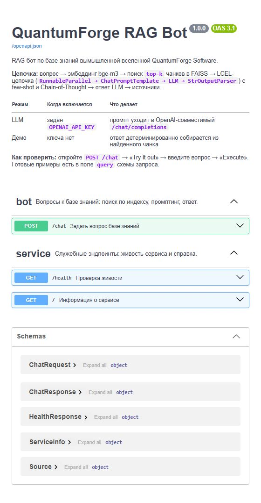

# Векторный индекс

Индекс собран по базе знаний из `knowledge_base/` — 38 документов о вымышленной вселенной Aetherium Concord.

## Модель эмбеддингов

| | |
|---|---|
| Модель | `BAAI/bge-m3` |
| Репозиторий | https://huggingface.co/BAAI/bge-m3 |
| Размерность | 1024 |
| Формат | ONNX int8 (`Xenova/bge-m3`), инференс через `onnxruntime`, пулинг по CLS-токену, L2-нормализация |

Модель эмбеддингов — не LLM: она только превращает текст в вектор, генерация ответов в индексации не участвует.

## Чанки

Документ режется готовой функцией `RecursiveCharacterTextSplitter` из `langchain-text-splitters`: по абзацам, затем по предложениям и словам, чтобы чанк не превышал 300 слов. Короткие хвосты склеиваются с соседними чанками, поэтому почти все чанки попадают в диапазон 100–300 слов.

| | |
|---|---|
| Чанков в индексе | 229 |
| Слов в чанке | 36–300, медиана 226 |
| Время генерации эмбеддингов | ~2 мин на CPU |

Каждый чанк хранит метаданные для цитирования: `chunk_id`, `source` (путь к файлу), `title`, `heading` (раздел), `start_char` / `end_char` (позиция в исходном файле), `words`.

## Файлы

- `faiss.index` — индекс FAISS (`IndexIDMap2` + `IndexFlatIP`, косинусная близость на нормализованных векторах).
- `chunks.json` — метаданные чанков и текст, по индексу совпадает с id в FAISS.
- `search_examples.md` — примеры запросов и найденные чанки.
- `rag_examples.md` — примеры диалогов RAG-бота (задание 4): 5 успешных и 2 случая «Я не знаю».

## Скрипты (tools/)

Скрипты этого задания — сборка индекса и поиск. Все три используют один и тот же энкодер, поэтому векторы чанков и запросов лежат в одном пространстве.

- **`tools/embedding.py`** — общая обёртка над `BAAI/bge-m3`. При первом запуске скачивает веса (ONNX int8, ~570 МБ) в `models/bge-m3/`, затем кодирует тексты батчами: токенизация с обрезкой до 512 токенов → инференс через `onnxruntime` → CLS-пулинг → L2-нормализация. Наружу отдаёт класс `BgeM3` с методом `encode(texts) -> np.ndarray`, который и вызывают остальные скрипты.

- **`tools/build_index.py`** — сборка индекса. Читает все `knowledge_base/*.md` (кроме `README.md`) и режет их на чанки готовым `RecursiveCharacterTextSplitter` (по абзацам → предложениям → словам, до 300 слов); короткие хвосты склеиваются с соседними. Каждый чанк кодируется и попадает в FAISS, затем сохраняются `index/faiss.index` и `index/chunks.json` (тексты и метаданные: `chunk_id`, `source`, `title`, `heading`, позиция в файле).

- **`tools/search_index.py`** — поиск по готовому индексу. Кодирует запрос той же моделью, находит `top-k` ближайших чанков в FAISS и печатает их с оценкой близости, `chunk_id`, источником, разделом и позицией в файле — именно эти сведения бот сможет приводить при ответе. Без аргументов прогоняет четыре примера запроса; `--save` кладёт результат в `search_examples.md`, `--json` отдаёт его машиночитаемо, `--top-k` задаёт число чанков.

- **`tools/rag_bot.py`** — ядро RAG-бота (задание 4). Поиск выполняет `retrieve()`, затем LCEL-цепочка на Runnable-ах (`RunnableParallel → ChatPromptTemplate → LLM → StrOutputParser`) подставляет few-shot, Chain-of-Thought и найденные фрагменты и вызывает LLM через OpenAI-совместимый API; `answer()` объединяет всё и отвечает «Я не знаю» при низком скоринге. Без `OPENAI_API_KEY` работает демо-режим: та же цепочка выполняется с заглушкой `DemoChat`, а ответ собирается из найденного фрагмента по шаблону.

- **`tools/api.py`** — REST-сервис FastAPI: `POST /chat` (вопрос → ответ с источниками), `GET /health`, `GET /docs`. Запускается через `docker-compose.yml`.

- **`tools/requirements.txt`** — не скрипт, а список зависимостей (`faiss-cpu`, `fastapi`, `langchain-core`, `langchain-text-splitters`, `numpy`, `onnxruntime`, `requests`, `tokenizers`, `uvicorn`), который ставит `Dockerfile`.

Скрипт `tools/build_knowledge_base.py` из этой же папки относится к заданию 2 — он только собирает документы `knowledge_base/` и к индексу не обращается.

## Запуск

Python на компьютере не нужен — всё считается в контейнере. Достаточно Docker Desktop.

### 1. Запустить Docker

Открыть Docker Desktop и дождаться, пока движок начнёт отвечать:

```powershell
docker info --format "{{.ServerVersion}}"
```

### 2. Собрать образ

Из корня проекта, там где лежит `Dockerfile`:

```powershell
cd C:\Project\lern\ya-architecture\architecture-ai
docker build -t quantumforge-rag .
```

Сборка занимает 2–3 минуты: скачивает зависимости из `tools/requirements.txt`. Повторять нужно только после изменения этого файла.

### 3. Запускать скрипты

Папку проекта надо смонтировать в `/app`, иначе контейнер не увидит базу знаний, индекс и веса модели:

```powershell
docker run --rm -v "C:\Project\lern\ya-architecture\architecture-ai:/app" quantumforge-rag tools/search_index.py
docker run --rm -v "C:\Project\lern\ya-architecture\architecture-ai:/app" quantumforge-rag tools/search_index.py "Who was Xarn Velgor?" --top-k 5
docker run --rm -v "C:\Project\lern\ya-architecture\architecture-ai:/app" quantumforge-rag tools/build_index.py
```

В bash тот же путь короче:

```bash
docker run --rm -v "$(pwd):/app" quantumforge-rag tools/search_index.py
```

Файлы, которые создаёт контейнер (`index/faiss.index`, `index/chunks.json`, `index/search_examples.md`), появляются сразу в папке проекта.

### Первый запуск

`build_index.py` скачивает веса модели (~570 МБ) в `models/bge-m3/` — через смонтированную папку, то есть на диск хоста. При следующем запуске они уже на месте. Папка `models/` в git не попадает.

### Без Docker

Если Python 3.12 уже установлен:

```bash
python -m pip install -r tools/requirements.txt
python tools/build_index.py
python tools/search_index.py
```

## REST-сервис RAG-бота (задание 4)

`tools/api.py` оборачивает ядро `tools/rag_bot.py` в HTTP-API. Удобнее всего
запускать через `docker-compose.yml` из корня проекта:

```powershell
docker compose up --build
```

Сервис поднимается на `http://localhost:8000`:

```powershell
# проверка живости
curl.exe http://localhost:8000/health

# вопрос к боту
curl.exe -X POST http://localhost:8000/chat -H "Content-Type: application/json" -d '{\"query\": \"Кто такой Арэн Велмор?\"}'
```

### Swagger UI



Интерактивная документация — `http://localhost:8000/docs` (Swagger UI),
альтернативная — `http://localhost:8000/redoc`, схема OpenAPI 3.1 —
`http://localhost:8000/openapi.json`.

Как проверить запрос из браузера:

1. Раскройте `POST /chat` → **Try it out**.
2. Выберите готовый пример из выпадающего списка (релевантный вопрос или
   «Как приготовить борщ?») либо введите свой.
3. **Execute** — ниже появятся код ответа, тело и заголовки.

Что размечено в схеме:

- теги `bot` и `service` с описаниями разделов;
- описания всех полей (`query`, `top_k`, `threshold`) и примеры значений;
- три примера запроса и полный пример ответа с источниками;
- коды `200`, `422` (некорректный запрос) и `502` (ошибка LLM).

| Метод | Путь | Назначение |
|---|---|---|
| `POST` | `/chat` | Вопрос → ответ с источниками |
| `GET` | `/health` | Живость и режим (LLM/демо) |
| `GET` | `/docs` | Swagger UI |
| `GET` | `/redoc` | ReDoc |
| `GET` | `/openapi.json` | Схема OpenAPI 3.1 |

Переменные окружения: `OPENAI_API_KEY` (без него — демо-режим), `OPENAI_BASE_URL`,
`LLM_MODEL`, `TOP_K`, `SCORE_THRESHOLD`. Ключ передаётся с хоста через compose и в
код не попадает. Примеры диалогов — в `rag_examples.md`.

## Пример запроса

```
Query: How does a fluxblade work and what crystal does it use?

  0.6764  fluxblade-001  (179 words)
    The fluxblade, also referred to as a laser sword by those who were unfamiliar with it,
    was a weapon usually used by the Fluxadept, Voidsworn, and other Flux-sensitives...

  0.6288  fluxblade-002  (219 words)
    Fluxblades were generally used for both offense and defense. A fluxblade could cut
    through virtually anything, from flesh to blast doors...
```

Полный список примеров — в `search_examples.md`.
